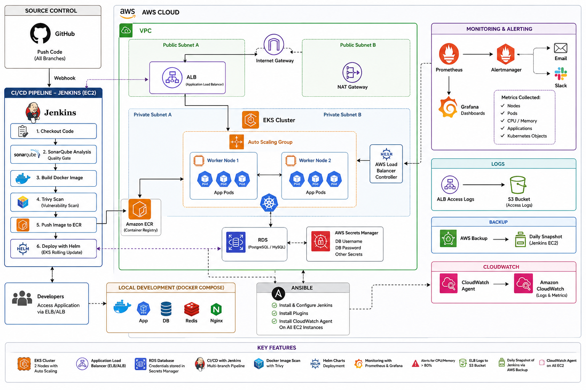
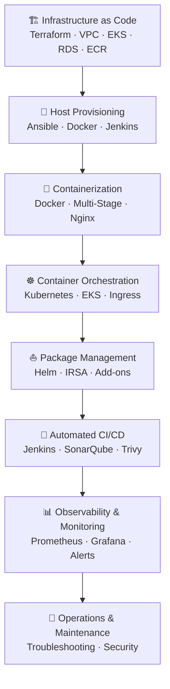

<h1 align="center">🚀 Step By Step NTI Cloud DevOps Final Project</h1>

<p align="center">
  <strong>A production-grade, end-to-end DevOps platform on AWS</strong>
</p>

<p align="center">
  
  
  
  
  
  
  
  
</p>

<p align="center">
  
  
  
  
  
  
  
  
</p>

---

## 📋 Table of Contents

- [Overview](#overview)
- [Architecture](#architecture)
- [Master 19-Lab Catalog & Specification Matrix](#master-19-lab-catalog--specification-matrix)
- [Repository Structure](#repository-structure)
- [Technology Stack](#technology-stack)
- [Prerequisites](#prerequisites)
- [Quick Start](#quick-start)
- [CI/CD Pipeline](#cicd-pipeline)
- [Monitoring & Alerting](#monitoring--alerting)
- [Security Controls](#security-controls)
- [Operational Documentation](#operational-documentation)
- [Contributing](#contributing)
- [License](#license)

---

<a id="overview"></a>
## 🎯 Overview

This project delivers a **complete, production-ready DevOps platform** built entirely on AWS. Developed as the final capstone for the **NTI Cloud DevOps Program**, it demonstrates mastery of the complete end-to-end DevOps lifecycle across **19 reproducible labs**:

| Capability | Implementation |
|---|---|
| **Infrastructure as Code** | Terraform modules for VPC, EKS, RDS, IAM, ECR, Backup, and S3 |
| **Configuration Management** | Ansible roles for Jenkins host automation & CloudWatch Agent |
| **Containerization** | Multi-stage Docker builds with Nginx reverse proxy |
| **Orchestration** | Kubernetes manifests + Helm charts on Amazon EKS |
| **CI/CD** | Jenkins multibranch pipeline with SonarQube & Trivy security gates |
| **Security Scanning** | SonarQube static analysis + Trivy container vulnerability scanning |
| **Observability** | Prometheus, Grafana dashboards, and Alertmanager |

The platform deploys a **Django web application** backed by **PostgreSQL (RDS)** and **Redis**, served through **Gunicorn** behind an **Nginx** reverse proxy, exposed to the internet via an **AWS Application Load Balancer**.

---

<a id="architecture"></a>
## 🏗 Architecture

<p align="center">
  
</p>



### Key Design Decisions

- **Public/Private Subnet Split**: Jenkins sits in a public subnet for webhook ingress, while EKS nodes and RDS reside in private subnets behind a NAT Gateway.
- **IRSA (IAM Roles for Service Accounts)**: The AWS Load Balancer Controller authenticates via IRSA, eliminating long-lived credentials inside containers.
- **Secrets Manager**: Database credentials are generated dynamically via AWS Secrets Manager and never hardcoded in version control.
- **Horizontal Pod Autoscaler (HPA)**: Application scales dynamically between 2 and 6 replicas based on CPU and memory utilization thresholds.

---

<a id="master-19-lab-catalog--specification-matrix"></a>
## 📄 Master 19-Lab Catalog & Specification Matrix

The repository is structured into **8 modular tracks** containing **19 self-contained labs**. Every lab satisfies the specification requirements :

| Lab # | Track | Target Lab Title | PDF Specification & Technical Function | Implementation Status |
|:---:|-------|------------------|----------------------------------------|:--------------------:|
| **Lab 01** | 01 · IaC | [Lab 01: AWS VPC, Subnets & Gateways](01-Infrastructure-Terraform/Lab01-AWS-VPC-Networking) | Custom VPC, Public/Private subnets, IGW, NAT Gateway | ✅ Implemented |
| **Lab 02** | 01 · IaC | [Lab 02: IAM Roles & Security Groups](01-Infrastructure-Terraform/Lab02-IAM-Security-Groups) | Least privilege IAM roles, IRSA OIDC trust, Security Groups | ✅ Implemented |
| **Lab 03** | 01 · IaC | [Lab 03: Amazon ECR & S3 Storage](01-Infrastructure-Terraform/Lab03-ECR-S3-Storage) | ECR repository (Scan-on-push) & S3 bucket for ALB logs | ✅ Implemented |
| **Lab 04** | 01 · IaC | [Lab 04: Amazon RDS & AWS Secrets Manager](01-Infrastructure-Terraform/Lab04-RDS-SecretsManager) | RDS PostgreSQL 16 & Secrets Manager DB passwords | ✅ Implemented |
| **Lab 05** | 01 · IaC | [Lab 05: Amazon EKS Cluster Provisioning](01-Infrastructure-Terraform/Lab05-EKS-Cluster-Provisioning) | EKS Cluster 1.34 & Managed Node Group (Auto Scaling) | ✅ Implemented |
| **Lab 06** | 01 · IaC | [Lab 06: Jenkins EC2 Instance & AWS Backup](01-Infrastructure-Terraform/Lab06-Jenkins-EC2-AWSBackup) | Jenkins EC2 + Elastic IP, S3 Backend & AWS Backup Vault | ✅ Implemented |
| **Lab 07** | 02 · Config | [Lab 07: Ansible Setup & Automated Inventory](02-Configuration-Management-Ansible/Lab07-Ansible-Inventory-Setup) | Ansible configuration & Dynamic Inventory script | ✅ Implemented |
| **Lab 08** | 02 · Config | [Lab 08: Automated Jenkins Server Provisioning](02-Configuration-Management-Ansible/Lab08-Jenkins-Server-Automation) | 8 Ansible roles: Jenkins, Docker, Java 17, CloudWatch Agent | ✅ Implemented |
| **Lab 09** | 03 · Docker | [Lab 09: Multi-Stage Dockerfile for Django](03-Containerization-Docker/Lab09-Django-MultiStage-Dockerfile) | Multi-stage build (`python:3.13-slim`), non-root `appuser` | ✅ Implemented |
| **Lab 10** | 03 · Docker | [Lab 10: Nginx & Docker Compose Stack](03-Containerization-Docker/Lab10-Nginx-DockerCompose-Stack) | Multi-container stack (Django, PostgreSQL, Redis, Nginx) | ✅ Implemented |
| **Lab 11** | 04 · K8s | [Lab 11: Core Kubernetes Workloads & Config](04-Kubernetes-Orchestration/Lab11-K8s-Workloads-Config) | Namespace, ConfigMap, Secret, Deployment (2 replicas), Service | ✅ Implemented |
| **Lab 12** | 04 · K8s | [Lab 12: Ingress Routing & ALB Controller](04-Kubernetes-Orchestration/Lab12-K8s-Ingress-ALB-Controller) | Ingress routing via AWS Load Balancer Controller | ✅ Implemented |
| **Lab 13** | 04 · K8s | [Lab 13: Kubernetes NetworkPolicies & HPA](04-Kubernetes-Orchestration/Lab13-K8s-Security-Autoscaling) | Zero-trust NetworkPolicy & HorizontalPodAutoscaler | ✅ Implemented |
| **Lab 14** | 05 · Helm | [Lab 14: Custom Helm Chart for Microservices](05-Helm-Package-Management/Lab14-Custom-Helm-Chart-App) | Parameterized Helm Chart (`myapp`) templates & values | ✅ Implemented |
| **Lab 15** | 05 · Helm | [Lab 15: Managing EKS Add-ons with Helm](05-Helm-Package-Management/Lab15-Helm-Cluster-Addons) | AWS LBC & Metrics Server Helm releases with IRSA | ✅ Implemented |
| **Lab 16** | 06 · CI/CD | [Lab 16: Jenkins Multibranch Pipeline](06-CICD-Jenkins-Pipeline/Lab16-Jenkins-Pipeline-Sonar-Trivy) | Declarative pipeline: SonarQube, Trivy, ECR, Helm deploy | ✅ Implemented |
| **Lab 17** | 07 · Monitor | [Lab 17: Deploying Kube-Prometheus-Stack](07-Monitoring-Observability/Lab17-Prometheus-Grafana-Monitoring-Stack) | Prometheus, Alertmanager & Grafana deployment on EKS | ✅ Implemented |
| **Lab 18** | 07 · Monitor | [Lab 18: Prometheus Alerts & Grafana Dashboards](07-Monitoring-Observability/Lab18-Alerts-Grafana-Dashboards) | 10 custom PrometheusRules (>80% alerts) & Grafana JSON | ✅ Implemented |
| **Lab 19** | 08 · Ops | [Lab 19: Day-2 Operations & Troubleshooting](08-Documentation-Operations/Lab19-End-To-End-Deployment-Operations) | Master deployment guide, credential rotation & troubleshooting | ✅ Implemented |

---

<a id="repository-structure"></a>
## 📁 Repository Structure

```text
NTI-Final-Project/
│
├── 01-Infrastructure-Terraform/                  # Track 01 — Infrastructure as Code (Terraform)
│   ├── Lab01-AWS-VPC-Networking/                 #   Lab 01: AWS VPC, Subnets, Gateways & Route Tables
│   ├── Lab02-IAM-Security-Groups/                #   Lab 02: IAM Roles, IRSA Policies & Security Groups
│   ├── Lab03-ECR-S3-Storage/                     #   Lab 03: Amazon ECR Container Registry & S3 Buckets
│   ├── Lab04-RDS-SecretsManager/                 #   Lab 04: Amazon RDS PostgreSQL & AWS Secrets Manager
│   ├── Lab05-EKS-Cluster-Provisioning/           #   Lab 05: Amazon EKS Cluster & Managed Node Groups
│   └── Lab06-Jenkins-EC2-AWSBackup/              #   Lab 06: Jenkins EC2 Instance, S3 Backend & AWS Backup
│
├── 02-Configuration-Management-Ansible/          # Track 02 — Configuration Management (Ansible)
│   ├── Lab07-Ansible-Inventory-Setup/            #   Lab 07: Ansible Architecture & Dynamic Inventory
│   └── Lab08-Jenkins-Server-Automation/          #   Lab 08: Automated Jenkins Server & Toolchain Setup
│
├── 03-Containerization-Docker/                     # Track 03 — Containerization (Docker)
│   ├── Lab09-Django-MultiStage-Dockerfile/       #   Lab 09: Production Multi-Stage Dockerfile for Django
│   └── Lab10-Nginx-DockerCompose-Stack/          #   Lab 10: Nginx Reverse Proxy & Docker Compose Stack
│
├── 04-Kubernetes-Orchestration/                   # Track 04 — Kubernetes Orchestration (EKS)
│   ├── Lab11-K8s-Workloads-Config/               #   Lab 11: Core K8s Workloads, ConfigMaps & Secrets
│   ├── Lab12-K8s-Ingress-ALB-Controller/         #   Lab 12: Ingress Routing & AWS ALB Controller
│   └── Lab13-K8s-Security-Autoscaling/           #   Lab 13: Kubernetes NetworkPolicies & HPA
│
├── 05-Helm-Package-Management/                    # Track 05 — Package Management (Helm)
│   ├── Lab14-Custom-Helm-Chart-App/              #   Lab 14: Creating a Custom Helm Chart for Django
│   └── Lab15-Helm-Cluster-Addons/                #   Lab 15: Managing EKS Add-ons with Helm & IRSA
│
├── 06-CICD-Jenkins-Pipeline/                       # Track 06 — CI/CD Pipeline (Jenkins)
│   └── Lab16-Jenkins-Pipeline-Sonar-Trivy/       #   Lab 16: Jenkins Multibranch Pipeline with Sonar & Trivy
│
├── 07-Monitoring-Observability/                  # Track 07 — Monitoring & Observability
│   ├── Lab17-Prometheus-Grafana-Monitoring-Stack/#   Lab 17: Deploying Kube-Prometheus-Stack on EKS
│   └── Lab18-Alerts-Grafana-Dashboards/          #   Lab 18: Custom Prometheus Alert Rules & Grafana Dashboards
│
├── 08-Documentation-Operations/                  # Track 08 — Day-2 Operations & Security
│   └── Lab19-End-To-End-Deployment-Operations/   #   Lab 19: Full Platform Operations & Troubleshooting Guide
│
├── Assets/                                        # Architecture Diagrams & Media Assets
│   └── arc_digram.png
│
└── README.md                                      # ← Master Documentation Entrypoint
```

---

<a id="technology-stack"></a>
## 🛠 Technology Stack

| Layer | Technology | Version | Purpose |
|---|---|---|---|
| ☁️ **Cloud** | AWS | — | Production cloud infrastructure hosting |
| 🏗 **IaC** | Terraform | ≥ 1.6 | Infrastructure as Code provisioning |
| ⚙️ **Config Mgmt** | Ansible | ≥ 2.15 | Server configuration automation |
| 🐳 **Containers** | Docker CE | latest | Application containerization |
| ☸️ **Orchestration** | Kubernetes (EKS) | 1.34 | Container orchestration |
| 📦 **Packaging** | Helm | 3.17 | Kubernetes package management |
| 🌐 **Application** | Django + Gunicorn | 5.2 LTS / 23.x | Web framework + WSGI server |
| 🐍 **Language** | Python | 3.13 | Primary application runtime |
| 🗄 **Database** | PostgreSQL (RDS) | 16 | Relational database storage |
| ⚡ **Cache** | Redis | 7 | In-memory session & cache store |
| 🔀 **Reverse Proxy** | Nginx | 1.27 | Load balancing & reverse proxying |
| 🔄 **CI/CD** | Jenkins LTS | 2.555 | Automated CI/CD pipeline |
| 🔍 **Code Quality** | SonarQube | latest | Static code analysis & quality gates |
| 🛡 **Security Scan** | Trivy | 0.70.0 | Container image vulnerability scanning |
| 📊 **Monitoring** | kube-prometheus-stack | 87.10.1 | Time-series metrics collection |
| 🚨 **Alerting** | Alertmanager | 0.33.1 | Alert routing & notification rules |
| 📈 **Dashboards** | Grafana | 10.x | Real-time metrics visualization |

---

<a id="prerequisites"></a>
## ✅ Prerequisites

Before deployment, ensure your workstation has the following CLI tools installed:

| Tool | Minimum Version | Installation Link |
|---|---|---|
| AWS CLI | v2 | [Install Guide](https://docs.aws.amazon.com/cli/latest/userguide/getting-started-install.html) |
| Terraform | ≥ 1.6 | [Install Guide](https://developer.hashicorp.com/terraform/tutorials/aws-get-started/install-cli) |
| Ansible | ≥ 2.15 | `pip install ansible` |
| Docker | latest | [Install Guide](https://docs.docker.com/engine/install/) |
| kubectl | 1.34 | [Install Guide](https://kubernetes.io/docs/tasks/tools/) |
| Helm | ≥ 3.x | [Install Guide](https://helm.sh/docs/intro/install/) |

**AWS Account Requirements:**
- Administrator permissions for VPC, EKS, RDS, EC2, IAM, ECR, S3, Secrets Manager, and Backup.
- Configured credentials: `aws configure`
- An SSH Key pair created in target region (`us-east-1`).

---

<a id="quick-start"></a>
## 🚀 Quick Start

### Step 1 — Provision Infrastructure (Terraform)
```bash
cd 01-Infrastructure-Terraform/Lab06-Jenkins-EC2-AWSBackup
terraform init
terraform plan -out=tfplan
terraform apply tfplan
```

### Step 2 — Configure Jenkins Server (Ansible)
```bash
cd 02-Configuration-Management-Ansible/Lab08-Jenkins-Server-Automation
./../Lab07-Ansible-Inventory-Setup/scripts/update-inventory.sh <JENKINS_PUBLIC_IP>
ansible-playbook -i ../Lab07-Ansible-Inventory-Setup/inventory/hosts.ini playbooks/site.yml
```

### Step 3 — Local Multi-Container Stack (Optional)
```bash
cd 03-Containerization-Docker/Lab10-Nginx-DockerCompose-Stack
docker compose up -d --build
curl http://localhost
```

### Step 4 — Deploy Kubernetes Workloads (EKS)
```bash
aws eks update-kubeconfig --name nti-devops-eks --region us-east-1
cd 04-Kubernetes-Orchestration/Lab11-K8s-Workloads-Config
kubectl apply -f namespace.yaml
kubectl apply -f configmap.yaml -f secret.yaml
kubectl apply -f deployment.yaml -f service.yaml
```

### Step 5 — Deploy via Helm & EKS Add-ons
```bash
cd 05-Helm-Package-Management/Lab14-Custom-Helm-Chart-App
helm install myapp myapp/ -n nti-devops
```

### Step 6 — Deploy Monitoring & Observability Stack
```bash
cd 07-Monitoring-Observability/Lab17-Prometheus-Grafana-Monitoring-Stack
./install/install.sh
kubectl port-forward svc/prometheus-grafana 3000:80 -n monitoring
```

---

<a id="cicd-pipeline"></a>
## 🔄 CI/CD Pipeline

The Jenkins multibranch pipeline is automatically triggered by **GitHub branch push events**:

```text
┌──────────┐   ┌────────────┐   ┌───────────┐   ┌───────────────┐
│ Checkout │──▶│ Unit Tests │──▶│ SonarQube │──▶│ Quality Gate  │
└──────────┘   └────────────┘   └───────────┘   └───────┬───────┘
                                                         │
                                               ┌─────────▼─────────┐
                                               │ Quality Gate Pass? │
                                               └─────────┬─────────┘
                                                         │ ✅
┌──────────────┐   ┌────────────┐   ┌──────────┐  ┌────▼────────┐
│ Helm Deploy  │◀──│ Push → ECR │◀──│ Trivy    │◀─│ Docker      │
│ (main only)  │   │            │   │ Scan     │  │ Build       │
└──────┬───────┘   └────────────┘   └──────────┘  └─────────────┘
       │
       ▼
┌──────────────┐
│ Deployment   │
│ Verification │
└──────────────┘
```

### Branch Strategy & Pipeline Features

| Branch | Pipeline Behavior | Target Environment |
|---|---|---|
| `main` | Full pipeline execution (Test ➔ Sonar ➔ Trivy ➔ ECR ➔ EKS) | Production (EKS) |
| `develop` | Build + Pytest unit test + SonarQube quality gate | Staging Validation |
| `feature/*` | Build + Pytest unit test | Developer Testing |

---

<a id="monitoring--alerting"></a>
## 📊 Monitoring & Alerting

### Custom Alert Rules (10 Rules)

| Category | Alert Name | Condition Threshold |
|---|---|---|
| **Resource** | `HostHighCpuLoad` | CPU utilization > 80% for 5m |
| **Resource** | `InstanceLowMemory` | Available memory < 20% |
| **Workload** | `KubePodCrashLooping` | Pod restarting > 5 times in 10m |
| **Workload** | `KubePodNotReady` | Pod in un-ready state > 15m |
| **Storage** | `PVCStorageUsageCritical` | Volume utilization > 85% |

---

<a id="security-controls"></a>
## 🔒 Security Controls

| Layer | Control Mechanism |
|---|---|
| **Network** | Public/Private subnet topology, Security Group chaining, EKS NetworkPolicies |
| **Compute** | IMDSv2 enforced on EC2 instances, non-root `USER appuser` containers |
| **Database** | KMS encrypted RDS PostgreSQL in private database subnets |
| **Credentials** | Dynamic secret generation via AWS Secrets Manager |
| **CI/CD** | Mandatory SonarQube quality gates & Trivy vulnerability scans |

---

<a id="operational-documentation"></a>
## 📚 Operational Documentation

- 📘 [Master Deployment Guide](08-Documentation-Operations/Lab19-End-To-End-Deployment-Operations/deployment-guide.md)
- 🛠️ [Troubleshooting Handbook](08-Documentation-Operations/Lab19-End-To-End-Deployment-Operations/troubleshooting-guide.md)
- 🔐 [Security & Credentials Management](08-Documentation-Operations/Lab19-End-To-End-Deployment-Operations/step_by_step_credentials.md)

---

<a id="contributing"></a>
## 🤝 Contributing

Contributions are welcome! Please follow standard pull request workflows.

---

<a id="license"></a>
## 📄 License

Developed as part of the **NTI (National Telecommunication Institute) DevOps Program** final project.

<p align="center">
  Built with ❤️ as part of the NTI DevOps Program
</p>
